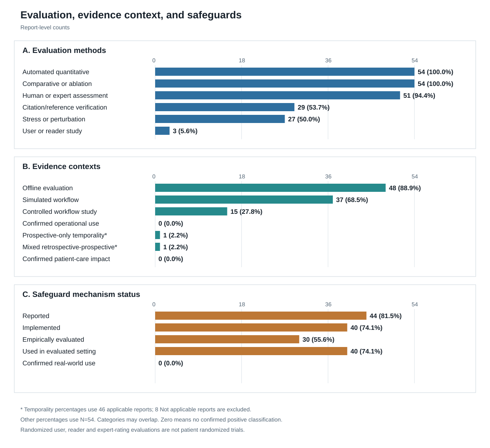

# Awesome Medical Agent Evaluation

A curated evidence map of medical AI agents powered by large language models, vision-language models, and multimodal foundation models, with a focus on reported evaluation methods, safety oversight, governance controls, and evidence characteristics.

This repository is designed as a public, GitHub-friendly companion resource for a scoping review of medical AI agents. It provides report-level bibliographic metadata and analytical coding with source links. It does **not** redistribute full-text PDFs or copyrighted article content.

## Scope

Included reports describe an empirically evaluated medical or biomedical workflow driven by an LLM, VLM, or multimodal foundation model. Eligibility requires a model-made control decision based on the current task state, linked to a downstream action and distinguishable state-dependent trajectories. Isolated model responses, component-only evaluations, conceptual frameworks and background sources are excluded from the analytical denominator. The complete workflow must have an identifiable task and empirical evaluation. See [inclusion criteria](docs/inclusion_criteria.md).

Unlike broad AI-in-medicine repositories, this project focuses specifically on **agentic medical AI systems** and charts evaluation methods, safety oversight, governance reporting, data sources, workflow context, and evidence characteristics.

## Included Reports

**Current analytical dataset: v1.0.4, October 14, 2026, 54 included reports.** The search cutoff was June 18, 2026; R255 is excluded from the synthesis. This version matches the final analytical values and the English appendix wording synchronized on October 14. Download the [54-report table](data/included_reports.csv) or the [complete machine-readable data package](data/frozen_54_report_release_v1.0.4/).

The [earlier v1.0.2 archive](data/frozen_54_report_release_v1.0.2/) and its [Zenodo deposit](https://doi.org/10.5281/zenodo.23124496) predate the current analytical revisions and must not be used to reproduce the current results. No new Zenodo DOI is asserted for v1.0.4. [Version history](docs/version_history.md) explains the changes.

Each row represents one report. DOI/source identifiers link to the corresponding public source; a blank DOI/source identifier means no DOI was recorded, while the source URL remains available. The report-level dimensions are descriptive and are not combined into a single maturity or safety score.

### Report list

The type shown below describes the report version used for analytical extraction. Bibliographic metadata separately identify later conference publications where applicable.

| Report ID | Report title | Year | Extracted report type | Primary intended use | Data-source nature | Temporality | Cited source |
|---|---|---:|---|---|---|---|---|
| R010 | MedAgentBench v2: Improving Medical LLM Agent Design. | 2026 | Conference proceedings | Health-system workflow | Unclear | Not applicable | [Source](https://doi.org/10.1142/9789819824755_0025) |
| R030 | Agentic memory-augmented retrieval and evidence grounding for medical question-answering tasks. | 2026 | Journal article | Clinical decision support | biomedical_non_patient | Not applicable | [Source](https://doi.org/10.1016/j.ijmedinf.2026.106339) |
| R033 | A neural-symbolic AI agent system for biomedical concept mapping. | 2026 | Journal article | Biomedical discovery / analysis | clinical_derived | Unclear | [Source](https://doi.org/10.1038/s41746-026-02594-6) |
| R041 | AgentClinic: a multimodal benchmark for tool-using clinical AI agents. | 2026 | Journal article | Evaluation infrastructure | mixed | Not applicable | [Source](https://doi.org/10.1038/s41746-026-02674-7) |
| R068 | MARTP: a multi-agent simulation framework for automated radiation therapy planning based on LLMs. | 2026 | Journal article | Clinical decision support | mixed | Retrospective | [Source](https://doi.org/10.1088/1361-6560/ae6af6) |
| R074 | EC2Seq2Sql: Patient-trial matching with LLM agents. | 2026 | Journal article | Clinical research / trial matching | clinical_derived | Retrospective | [Source](https://doi.org/10.1371/journal.pone.0341827) |
| R081 | AI Agent for Delirium Screening among Patients in Oncology and Cardiac Intensive Care Units: A Proof-of-Concept Study. | 2026 | Journal article | Clinical decision support | clinical_derived | Retrospective | [Source](https://doi.org/10.1093/eurjcn/zvag029) |
| R096 | AutoMedic: An Automated Evaluation Framework for Clinical Conversational Agents with Medical Dataset Grounding | 2026 | Journal article | Evaluation infrastructure | synthetic_or_simulated | Not applicable | [Source](https://doi.org/10.1109/JBHI.2026.3703097) |
| R138 | Large Language Model Agent for Managing Patients With Suspected Hypertension | 2026 | Original article | Clinical decision support | clinical_derived | Mixed | [Source](https://doi.org/10.1161/hypertensionaha.125.25305) |
| R231 | Pharmacokinetics-Informed Agentic Architecture for Drug Dynamics with LLM-Driven In Silico Patients | 2026 | Journal article | Clinical decision support | synthetic_or_simulated | Not applicable | [Source](https://doi.org/10.3390/math14101627) |
| R271 | DoctorAgent-RL: A Multi-Agent Collaborative Reinforcement Learning System for Multi-Turn Clinical Dialogue | 2026 | Conference paper | Clinical decision support | mixed | Unclear | [Source](https://doi.org/10.1109/icassp55912.2026.11460976) |
| R279 | Towards the Reliability of Agentic Artificial Intelligence Models in Healthcare | 2026 | Conference paper | Evaluation infrastructure | mixed | Unclear | [Source](https://doi.org/10.1109/rams50514.2026.11424519) |
| R325 | Exploring the Future of AI in Clinical Collaboration: A Study on Tumor Board Case Preparation | 2026 | Conference paper | Health-system workflow | clinical_derived | Prospective | [Source](https://doi.org/10.1145/3772318.3790448) |
| R358 | Towards autonomous medical artificial intelligence agents. | 2026 | Journal article | Health-system workflow | clinical_derived | Retrospective | [Source](https://doi.org/10.1038/s41586-026-10675-5) |
| R365 | DART: Leveraging Multi-Agent Disagreement for Tool Recruitment in Multimodal Reasoning | 2026 | Conference paper | Biomedical discovery / analysis | clinical_derived | Unclear | [Source](https://doi.org/10.18653/v1/2026.eacl-long.253) |
| R369 | Infherno: End-to-end Agent-based FHIR Resource Synthesis from Free-form Clinical Notes | 2026 | Conference paper | Health-system workflow | clinical_derived | Retrospective | [Source](https://aclanthology.org/2026.eacl-demo.13/) |
| R371 | PaperSearchQA: Learning to Search and Reason over Scientific Papers with RLVR | 2026 | Conference paper | Biomedical discovery / analysis | synthetic_or_simulated | Unclear | [Source](https://doi.org/10.18653/v1/2026.eacl-long.88) |
| R447 | MedCTA: A Benchmark for Clinical Tool Agents | 2026 | Preprint | Evaluation infrastructure | mixed | Retrospective | [Source](https://arxiv.org/abs/2606.11702v1) |
| R451 | DUCX: Decomposing Unfairness in Tool-Using Chest X-ray Agents | 2026 | Preprint | Evaluation infrastructure | clinical_derived | Unclear | [Source](https://arxiv.org/abs/2603.00777v2) |
| R452 | MedScope: Incentivizing "Think with Videos" for Clinical Reasoning via Coarse-to-Fine Tool Calling | 2026 | Preprint | Biomedical discovery / analysis | clinical_derived | Unclear | [Source](https://arxiv.org/abs/2602.13332v1) |
| R453 | ART: Action-based Reasoning Task Benchmarking for Medical AI Agents | 2026 | Preprint | Evaluation infrastructure | mixed | Unclear | [Source](https://arxiv.org/abs/2601.08988v1) |
| R460 | Counterfactual Evaluation Reveals Hidden Capability Profiles in Clinical LLMs and Agents | 2026 | Preprint | Evaluation infrastructure | clinical_derived | Unclear | [Source](https://arxiv.org/abs/2605.30590v1) |
| R467 | A Machine-to-Machine Knowledge-Guided LLM Agent for Generalizable Radiotherapy Treatment Planning | 2026 | Preprint | Clinical decision support | mixed | Retrospective | [Source](https://arxiv.org/abs/2606.00922v1) |
| R469 | PhysicianBench: Evaluating LLM Agents in Real-World EHR Environments | 2026 | Preprint | Evaluation infrastructure | mixed | Retrospective | [Source](https://arxiv.org/abs/2605.02240v1) |
| R475 | Can LLM Agents Generate Real-World Evidence? Evaluating Observational Studies in Medical Databases | 2026 | Preprint | Clinical research | clinical_derived | Retrospective | [Source](https://arxiv.org/abs/2603.22767v1) |
| R476 | OpenHospital: A Thing-in-itself Arena for Evolving and Benchmarking LLM-based Collective Intelligence | 2026 | Preprint | Evaluation infrastructure | synthetic_or_simulated | Unclear | [Source](https://arxiv.org/abs/2603.14771v3) |
| R524 | Cerebra: A Multidisciplinary AI Board for Multimodal Dementia Characterization and Risk Assessment | 2026 | Preprint | Clinical decision support | clinical_derived | Retrospective | [Source](https://arxiv.org/abs/2603.21597v2) |
| R529 | A Multi-Agent Framework for Interpreting Multivariate Physiological Time Series | 2026 | Preprint | Clinical decision support | clinical_derived | Unclear | [Source](https://arxiv.org/abs/2603.04142v1) |
| R001 | Development and validation of an autonomous artificial intelligence agent for clinical decision-making in oncology. | 2025 | Journal article | Clinical decision support | mixed | Not applicable | [Source](https://doi.org/10.1038/s43018-025-00991-6) |
| R141 | Large language model agents can use tools to perform clinical calculations | 2025 | Journal article | Clinical decision support | synthetic_or_simulated | Unclear | [Source](https://doi.org/10.1038/s41746-025-01475-8) |
| R142 | An Adaptive Multi-Agent LLM-Based Clinical Decision Support System Integrating Biomedical RAG and Web Intelligence | 2025 | Journal article | Clinical decision support | mixed | Unclear | [Source](https://doi.org/10.1109/access.2025.3613340) |
| R300 | Multi-Planners in Plan-and-Solve Prompting for Medical Reasoning | 2025 | Conference paper | Clinical decision support | synthetic_or_simulated | Not applicable | [Source](https://doi.org/10.1109/bigdata66926.2025.11402280) |
| R375 | 3MDBench: Medical Multimodal Multi-agent Dialogue Benchmark | 2025 | Conference paper | Evaluation infrastructure | mixed | Unclear | [Source](https://doi.org/10.18653/v1/2025.emnlp-main.1353) |
| R377 | A Knowledge-driven Adaptive Collaboration of LLMs for Enhancing Medical Decision-making | 2025 | Conference paper | Clinical decision support | clinical_derived | Unclear | [Source](https://doi.org/10.18653/v1/2025.emnlp-main.1699) |
| R378 | A Multi-Agent Framework with Diagnostic Feedback for Iterative Plain Language Summary Generation from Cochrane Medical Abstracts | 2025 | Conference paper | Biomedical discovery / analysis | mixed | Unclear | [Source](https://doi.org/10.18653/v1/2025.tsar-1.6) |
| R381 | AI Hospital: Benchmarking Large Language Models in a Multi-agent Medical Interaction Simulator | 2025 | Conference paper | Evaluation infrastructure | mixed | Unclear | [Source](https://aclanthology.org/2025.coling-main.680/) |
| R397 | EmoAgent: Assessing and Safeguarding Human-AI Interaction for Mental Health Safety | 2025 | Conference paper | Safety infrastructure | synthetic_or_simulated | Not applicable | [Source](https://doi.org/10.18653/v1/2025.emnlp-main.594) |
| R406 | MEDDxAgent: A Unified Modular Agent Framework for Explainable Automatic Differential Diagnosis | 2025 | Conference paper | Clinical decision support | mixed | Unclear | [Source](https://doi.org/10.18653/v1/2025.acl-long.677) |
| R407 | MeNTi: Bridging Medical Calculator and LLM Agent with Nested Tool Calling | 2025 | Conference paper | Clinical decision support | mixed | Unclear | [Source](https://aclanthology.org/2025.naacl-long.263/) |
| R418 | ReflecTool: Towards Reflection-Aware Tool-Augmented Clinical Agents | 2025 | Conference paper | Evaluation infrastructure | clinical_derived | Unclear | [Source](https://doi.org/10.18653/v1/2025.acl-long.663) |
| R454 | Incentivizing Tool-augmented Thinking with Images for Medical Image Analysis | 2025 | Preprint | Clinical decision support | mixed | Unclear | [Source](https://arxiv.org/abs/2512.14157v1) |
| R455 | CP-Env: Evaluating Large Language Models on Clinical Pathways in a Controllable Hospital Environment | 2025 | Preprint | Evaluation infrastructure | mixed | Unclear | [Source](https://arxiv.org/abs/2512.10206v2) |
| R461 | MedAgentBench: A Realistic Virtual EHR Environment to Benchmark Medical LLM Agents | 2025 | Preprint | Evaluation infrastructure | clinical_derived | Unclear | [Source](https://arxiv.org/abs/2501.14654v2) |
| R484 | Simulating Viva Voce Examinations to Evaluate Clinical Reasoning in Large Language Models | 2025 | Preprint | Evaluation infrastructure | clinical_derived | Unclear | [Source](https://doi.org/10.52202/085713-4269) |
| R491 | Lessons Learned from Evaluation of LLM based Multi-agents in Safer Therapy Recommendation | 2025 | Preprint | Clinical decision support | clinical_derived | Retrospective | [Source](https://arxiv.org/abs/2507.10911v1) |
| R493 | AUTOCT: Automating Interpretable Clinical Trial Prediction with LLM Agents | 2025 | Preprint | Clinical research | clinical_derived | Unclear | [Source](https://doi.org/10.18653/v1/2025.emnlp-main.1575) |
| R499 | Autonomous Radiotherapy Treatment Planning Using DOLA: A Privacy-Preserving, LLM-Based Optimization Agent | 2025 | Preprint | Clinical decision support | clinical_derived | Retrospective | [Source](https://arxiv.org/abs/2503.17553v1) |
| R509 | MedicalOS: An LLM Agent based Operating System for Digital Healthcare | 2025 | Preprint | Health-system workflow | synthetic_or_simulated | Unclear | [Source](https://arxiv.org/abs/2509.11507v1) |
| R511 | Before Humans Join the Team: Diagnosing Coordination Failures in Healthcare Robot Team Simulation | 2025 | Preprint | Evaluation infrastructure | synthetic_or_simulated | Unclear | [Source](https://arxiv.org/abs/2508.04691v2) |
| R514 | GuardAgent: Safeguard LLM Agents by a Guard Agent via Knowledge-Enabled Reasoning | 2025 | Conference proceedings | Safety infrastructure | mixed | Unclear | [Source](https://arxiv.org/abs/2406.09187v3) |
| R543 | MedAI: Evaluating TxAgent's Therapeutic Agentic Reasoning in the NeurIPS CURE-Bench Competition | 2025 | Preprint | Clinical decision support | mixed | Unclear | [Source](https://arxiv.org/abs/2512.11682v2) |
| R458 | Towards Next-Generation Medical Agent: How o1 is Reshaping Decision-Making in Medical Scenarios | 2024 | Preprint | Clinical decision support | clinical_derived | Unclear | [Source](https://arxiv.org/abs/2411.14461v1) |
| R501 | Enhancing LLMs for Impression Generation in Radiology Reports through a Multi-Agent System | 2024 | Preprint | Clinical decision support | clinical_derived | Unclear | [Source](https://arxiv.org/abs/2412.06828v1) |
| R503 | Adaptive Reasoning and Acting in Medical Language Agents | 2024 | Preprint | Clinical decision support | mixed | Unclear | [Source](https://arxiv.org/abs/2410.10020v1) |

## Related Reviews

Related reviews of medical AI agents, agentic AI in healthcare, biomedical agents, and domain-specific medical-agent systems. These contextual sources are not part of the 54 reports included in the scoping review. A machine-readable version is available at [`data/related_reviews.csv`](data/related_reviews.csv).

| Related review                                                                                                                                                                     | Year | DOI/URL                                                                                |
| ----------------------------------------------------------------------------------------------------------------------------------------------------------------------------------- | ---: | -------------------------------------------------------------------------------------- |
| Alhazba SA, Ali MH, Alawi DA, et al. From Reactive AI to Agentic Systems: A Review of Autonomous medical AI Agents in Healthcare.                                                   | 2026 | [10.1007/s11831-026-10655-y](https://doi.org/10.1007/s11831-026-10655-y)               |
| Branda F, Ahmed MM, Ciccozzi M, et al. The next paradigm in bioinformatics: a review of multi-agent systems and foundational models for end-to-end scientific discovery.            | 2026 | [10.1093/bib/bbag245](https://doi.org/10.1093/bib/bbag245)                             |
| Chen LF, Xu XM, Qin YM, et al. Vision-language foundation model driven agentic AI systems for healthcare.                                                                           | 2026 | [10.1007/s00371-026-04437-7](https://doi.org/10.1007/s00371-026-04437-7)               |
| Chen XL, Chen RY, Xu PS, et al. From visual question answering to intelligent AI agents in ophthalmology.                                                                           | 2026 | [10.1136/bjo-2024-326097](https://doi.org/10.1136/bjo-2024-326097)                     |
| Chen Y, Qin XQ, Chen SP. Foundation Models and AI Agents in Digital Pathology Imaging: A Systematic Review of Integration into the Clinical Workflow and Implementation Challenges. | 2026 | [10.1007/s10278-026-02034-7](https://doi.org/10.1007/s10278-026-02034-7)               |
| Dip SA, Mallick D, Shuvo UA, et al. Large language model agents for biological intelligence across genomics, proteomics, spatial biology, and biomedicine.                          | 2026 | [10.1093/bib/bbag110](https://doi.org/10.1093/bib/bbag110)                             |
| Ghanwatkar Y, Rajdeo P, Mahato RI. Foundation models and AI agents in oncology drug discovery.                                                                                      | 2026 | [10.1016/j.drudis.2026.104655](https://doi.org/10.1016/j.drudis.2026.104655)           |
| Guo XT, Chen J, Zhang YY, et al. Precision oncology: from large language models to multi-agent systems.                                                                             | 2026 | [10.3389/fonc.2026.1828507](https://doi.org/10.3389/fonc.2026.1828507)                 |
| Huynh DL, Seal S, Reid D, et al. AI agents in drug discovery: applications and case studies.                                                                                        | 2026 | [10.1016/j.drudis.2026.104650](https://doi.org/10.1016/j.drudis.2026.104650)           |
| Ma AR, Chen JY, Yang ZY. From Tool to Agent: A Semi-Systematic Review of Human-AI Alignment and a Proposed Tiered Healing Ecosystem for Mental Health.                              | 2026 | [10.3390/healthcare14060820](https://doi.org/10.3390/healthcare14060820)               |
| Qi C, Wang WB, Jiang SQ, et al. Artificial Intelligence agents for biological research: a survey.                                                                                   | 2026 | [10.1093/bib/bbag075](https://doi.org/10.1093/bib/bbag075)                             |
| Salehi S, Keishing V, Singh Y, et al. Systematic Review: Agentic AI in Neuroradiology: Technical Promise with Limited Clinical Evidence.                                            | 2026 | [10.1007/s10278-025-01839-2](https://doi.org/10.1007/s10278-025-01839-2)               |
| Silveira AL, Righi RR, da Costa CA. Multi-agent systems for clinical decision support: A systematic review.                                                                         | 2026 | [10.1016/j.asoc.2025.114447](https://doi.org/10.1016/j.asoc.2025.114447)               |
| Soetikno BT, Nielsen CS, Pollreisz A, et al. Toward autonomous discovery: agentic AI and the future of ophthalmic research.                                                         | 2026 | [10.1097/ICU.0000000000001179](https://doi.org/10.1097/ICU.0000000000001179)           |
| Srinivasu P, Aruna Kumari GL, Ahmed S, et al. Exploring agentic AI in healthcare: a study on its working mechanism.                                                                 | 2026 | [10.3389/fmed.2025.1753443](https://doi.org/10.3389/fmed.2025.1753443)                 |
| Tzanis E, Adams LC, D'Antonoli TA, et al. Agentic systems in radiology: Principles, opportunities, privacy risks, regulation, and sustainability concerns.                          | 2026 | [10.1016/j.diii.2025.10.002](https://doi.org/10.1016/j.diii.2025.10.002)               |
| Vatsal S, Dubey H, Singh A. Agentic AI in Healthcare and Medicine: A Seven-Dimensional Taxonomy for Empirical Evaluation of LLM-Based Agents.                                       | 2026 | [10.1109/access.2026.3651218](https://doi.org/10.1109/access.2026.3651218)             |
| Venerito V, Lopalco G, Iannone F, et al. Agentic AI in rheumatology.                                                                                                                | 2026 | [10.1016/S2665-9913(26)00076-7](<https://doi.org/10.1016/S2665-9913(26)00076-7>)       |
| Xu G, Li X, Chen Y, et al. A comprehensive survey of AI agents in healthcare.                                                                                                       | 2026 | [10.1016/j.jbi.2026.105045](https://doi.org/10.1016/j.jbi.2026.105045)                 |
| Zhao L, Liu S, Xin T, et al. AI agent in healthcare: applications, evaluations, and future directions.                                                                              | 2026 | [10.1038/s44387-026-00076-4](https://doi.org/10.1038/s44387-026-00076-4)               |
| Salehi S, Singh Y, Horst KK, et al. Agentic AI and Large Language Models in Radiology: Opportunities and Hallucination Challenges.                                                  | 2025 | [10.3390/bioengineering12121303](https://doi.org/10.3390/bioengineering12121303)       |
| Wang W, Ma Z, Wang Z, et al. A survey of LLM-based agents in medicine: how far are we from Baymax?                                                                                  | 2025 | [10.18653/v1/2025.findings-acl.539](https://doi.org/10.18653/v1/2025.findings-acl.539) |
| Xu X, Sankar R. Large language model agents for biomedicine: a comprehensive review of methods, evaluations, challenges, and future directions.                                     | 2025 | [10.3390/info16100894](https://doi.org/10.3390/info16100894)                           |
| Yang TT, Xiao YH, Bao ZJ, et al. The rise and potential opportunities of large language model agents in bioinformatics and biomedicine.                                             | 2025 | [10.1093/bib/bbaf601](https://doi.org/10.1093/bib/bbaf601)                             |

## Evidence Profile

These are report-level descriptive dimensions, not a maturity or clinical-readiness score. Workflow indicators and design labels may overlap.

- Extracted report type: 24 preprints (44.4%), 15 conference papers (27.8%), 2 conference proceedings (3.7%) and 13 journal articles (24.1%). Formal publication citations for AutoCT and VivaBench are retained alongside the preprint versions used for extraction; this does not retrospectively change extracted-report type.
- Data-source nature: 23 clinical-derived (42.6%), 20 mixed (37.0%), 9 synthetic or simulated (16.7%), 1 biomedical non-patient (1.9%) and 1 Unclear (1.9%).
- Data-source coverage: 1 Complete (1.9%), 16 Partial (29.6%) and 37 Unclear (68.5%). This is not reporting quality or study quality.
- Workflow: offline evaluation in 48 reports (88.9%), simulated workflow in 37 (68.5%) and controlled workflow studies in 15 (27.8%). Operational workflow use has no confirmed positive code: 51 No, 1 Not reported and 2 Unclear.
- Setting: clinical-operational in 31 reports (57.4%), research environment in 22 (40.7%) and Not applicable in 1 (1.9%). A clinically relevant setting does not establish operational use.
- Design/allocation: 3 reports (5.6%) report randomized allocation in a user, reader or paired expert-rating evaluation. No included report is classified as a patient randomized trial. The old randomized/non-randomized controlled hierarchy is not used in the current dataset.
- Temporality: among 46 applicable reports, 12 Retrospective (26.1%), 1 Prospective (2.2%), 1 Mixed (2.2%) and 32 Unclear (69.6%). Eight Not applicable reports are excluded. Mixed remains separate; 2 reports contain a prospective component.
- Actual human participation: 26 Yes, 2 No, 25 Not reported and 1 Unclear. Structured user/reader studies: 3 Yes, 2 No and 49 Not reported. These are different variables.
- Patient-care impact: no confirmed positive code; 52 No and 2 Unclear. This does not prove that clinical effects never occurred.
- Safeguards/governance: at least one mechanism Reported in 44 reports (81.5%), implemented in 40 (74.1%), empirically evaluated in 30 (55.6%) and used in the evaluated setting in 40 (74.1%). Confirmed real-world use is 0. These states were assessed separately and do not establish mechanism effectiveness.
- At least one safety-outcome category was reported in 38 reports (70.4%); S99 is excluded. Co-reporting does not imply a causal relationship.

Original reviewer-specific A/B coding was not modified. Released agreement and kappa statistics describe the original coding, not the subsequent analytical adjustments. See the [data package](data/frozen_54_report_release_v1.0.4/) for metric-category data, design labels, denominators and coding definitions.

## Repository Policy

The repository provides bibliographic links and structured review data. It does not host article PDFs, copyrighted full text, or long verbatim excerpts. Third-party bibliographic records and source links remain subject to their respective rights and terms.

## Citation

Please cite the associated scoping review and this repository. Repository citation metadata are provided in [`CITATION.cff`](CITATION.cff). For the current report-level analysis, identify dataset version `1.0.4` and the repository commit used. No separate DOI is asserted for this version; the earlier Zenodo archive is not the current analytical dataset.
